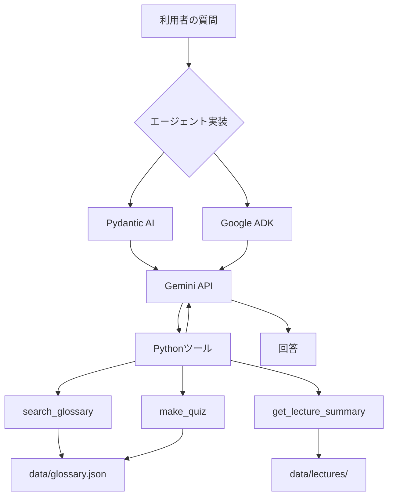

# AIE2026 — LLM・AIエージェントの実装と評価

東京大学 松尾・岩澤研究室「AIエンジニアリング実践講座 2026」の教材をもとに、LLMの応答特性、LoRAによる追加学習、検索ツールを利用するAIエージェントについて実装・比較評価した記録です。

単にプログラムが動作することだけでなく、**実験条件の統一、失敗事例の分析、評価指標の妥当性、結果の再現可能性**を重視しています。

> 本リポジトリは講座教材をforkして作成した個人の演習・発展課題の成果物です。講座の公式リポジトリではありません。元の教材は [matsuolab/lecture-ai-engineering-2026](https://github.com/matsuolab/lecture-ai-engineering-2026) を参照してください。

## 取り組みの概要

| 回 | テーマ | 主な取り組み | 実験結果・詳細 |
| --- | --- | --- | --- |
| 第1回 | LLM APIの利用・評価 | Gemini APIの応答時間、トークン消費、回答品質を比較 | [第1回の提出PR #1](https://github.com/mathkumamoto2/lecture-ai-engineering-2026/pull/1) |
| 第2回 | LoRA・SFTと検索方式 | 講座用語集58件を用いた追加学習と、出典参照方式を比較 | [第2回の提出PR #2](https://github.com/mathkumamoto2/lecture-ai-engineering-2026/pull/2) |
| 第3回 | AIエージェントとツール呼び出し | Pydantic AIとGoogle ADKで同一の学習支援エージェントを構築・比較 | [第3回の技術報告](lectures/03/answer.md) |

### 第1回：LLMの応答特性

複数モデル・質問条件に対して計54回のAPI呼び出しを試み、44回が成功、10回がAPIエラーとなりました。応答時間、トークン使用量、参照資料の有無による回答の違いを記録しています。回答品質の判定はAIによる一次評価であり、独立した人手採点ではありません。

### 第2回：LoRAによる追加学習と検索

講座用語集58件からSFTデータを構築し、`Qwen/Qwen3.5-0.8B` にLoRAを適用しました。独自の32問で学習前後を評価したところ、JSON形式遵守率は **32/32 → 29/32**、`needs_review` 判定一致は **23/32 → 24/32** でした。

追加学習がすべての指標を改善するとは限らないため、検索・生成・出典検証を分離した方式についても検討・評価しました。検索方式による最終出典一致にはプログラムによるフォールバックが含まれるため、LLM単体の正答率とは区別しています。

### 第3回：Pydantic AIとGoogle ADKの比較

講座用語集を利用する学習支援エージェントを、Pydantic AIとGoogle ADKの2方式で構築しました。モデル、指示文、Pythonツール、質問を共通化し、**8種類の質問を各2回、両方式で計32回**実行しました。

| 指標 | Pydantic AI | Google ADK |
| --- | ---: | ---: |
| 実行成功 | 16/16 | 16/16 |
| 期待するツールの呼び出し | 16/16 | 16/16 |
| `search_glossary` 呼び出し総数 | 13 | 10 |
| `get_lecture_summary` 呼び出し総数 | 4 | 4 |
| `make_quiz` 呼び出し総数 | 4 | 4 |
| 応答時間の中央値 | 1.98秒 | 1.61秒 |

実験環境：Python 3.12.16、Pydantic AI 2.57.0、Google ADK 2.14.0、`gemini-3.5-flash-lite`。

両方式とも必要なツールを呼び出せた一方、検索回数と回答内容には差が見られました。例えば「RAGとは？」への応答では、Pydantic AI側で検索語の展開と再検索が発生しました。なお、**ツール呼び出し成功率や文字列検査の結果は、回答の意味的正答率を表しません**。応答時間の差も、少数試行からフレームワーク全般の優劣を示すものではありません。

実測ログ、回答原文、ツール呼び出し履歴、評価基準および限界は [第3回の比較レポート](lectures/03/evidence/comparison_report.md) と [実測JSON](lectures/03/evidence/comparison.json) に記録しています。

## システム構成



2方式で共通の `INSTRUCTIONS` とツール関数を利用し、フレームワークの違いによる挙動を比較します。

### 主要ファイル

| パス | 役割 |
| --- | --- |
| [`app/agent.py`](app/agent.py) | Pydantic AI版エージェント、共通指示、実行CLI |
| [`app/tools.py`](app/tools.py) | 用語集検索・講義要約・確認問題のツール実装 |
| [`adk_agent/glossary_agent/agent.py`](adk_agent/glossary_agent/agent.py) | Google ADK版エージェント |
| [`scripts/lec03_compare.py`](scripts/lec03_compare.py) | 両方式の実測、ログ保存、途中再開 |
| [`scripts/lec03_eval.py`](scripts/lec03_eval.py) | 評価ケース・集計ロジック |
| [`lectures/03/answer.md`](lectures/03/answer.md) | 第3回の実装、結果、考察をまとめた報告 |
| [`lectures/03/evidence/`](lectures/03/evidence/) | 比較データ、回答原文、人手評価用シート |
| [`tests/`](tests/) | ツールと評価処理のオフラインテスト |

## 実行環境と検証

Python 3.12と[`uv`](https://docs.astral.sh/uv/)を使用します。LLMを利用する機能にはGoogle AI StudioのAPIキーを環境変数 `GEMINI_API_KEY` として設定する必要があります。APIキーはリポジトリ内に保存しません。

依存関係のセットアップとオフラインテスト：

```bash
uv sync --frozen
uv run pytest -q
```

Pydantic AI版の実行例：

```bash
uv run python -m app.agent --trace "LoRAとQLoRAの違いは？"
```

Google ADK版の対話実行例：

```bash
PYTHONPATH=. uv run --with 'google-adk>=2,<3' adk run adk_agent/glossary_agent
```

比較実験の実行条件と結果の保存方法は [`scripts/lec03_compare.py`](scripts/lec03_compare.py) と [第3回の技術報告](lectures/03/answer.md) に記載しています。既存の記録がある場合、比較スクリプトは不用意な上書きを防ぐため、実験計画の一致と `--resume` の指定を確認します。

## 評価上の留意点

- **動作成功と内容の正確性は異なります。** ツールが適切に呼ばれても、最終回答の根拠への忠実性は別途評価する必要があります。
- **人手評価は未完了です。** 第3回の `human_review.csv` は評価用の記録欄であり、人手採点済みのデータではありません。
- **比較条件には制約があります。** 共通のモデルID・指示・ツールを使用しましたが、SDK内部の生成設定やAPI負荷は完全には統制できません。
- **結果の一般化には限界があります。** 第2回は単一seed、第3回は各条件2反復の実験です。統計的な優位性や実運用での性能を保証するものではありません。

## 関連資料

- [AIE2026 講座教材（上流リポジトリ）](https://github.com/matsuolab/lecture-ai-engineering-2026)
- [Pydantic AI ドキュメント](https://ai.pydantic.dev/)
- [Google ADK ドキュメント](https://adk.dev/)
